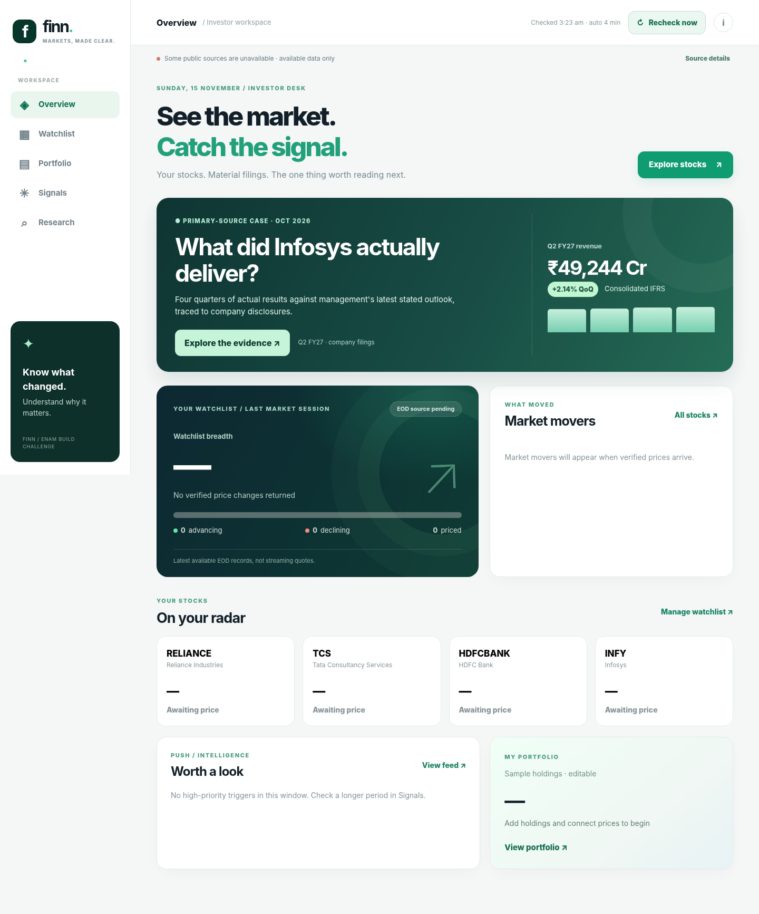
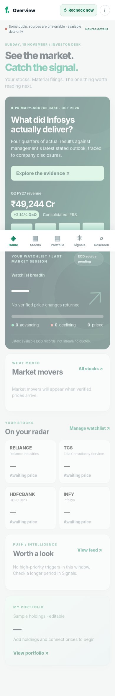
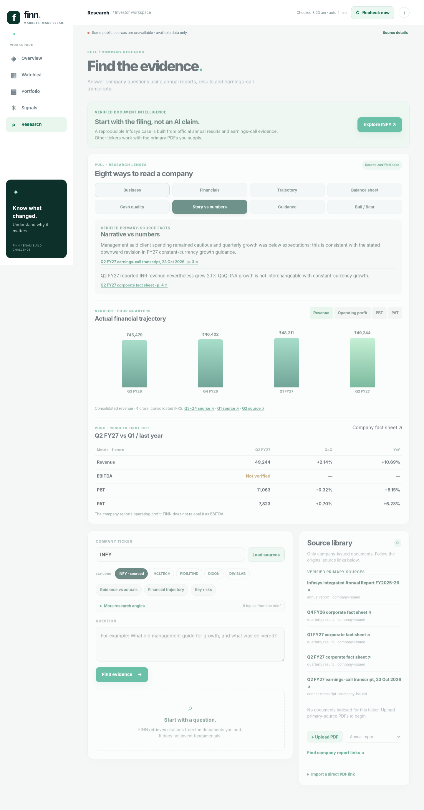
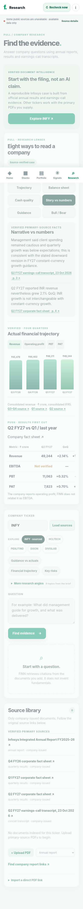

# FINN — Signal over noise

**ENAM AI Engineer Build Challenge • FINN v4.0.0 • Mobile-first FastAPI + responsive web app**

FINN is a source-first investment intelligence prototype. It solves two investor jobs:

- **Push — “What changed?”** A ranked NSE corporate-filing inbox, 17 filing categories, selectable 24 h/7 d/30 d windows, abnormal EOD price/volume rules, browser notifications for *new* priority filings while open, and source-opening actions.
- **Pull — “Why does this matter?”** A company-research workspace grounded in annual reports, results and earnings-call transcripts, with source-linked findings, eight analysis lenses, a reproducible **real Infosys four-quarter case**, and a generic, source-cited PDF research engine for other companies.

A deliberate distinction: **market prices are best-effort public-provider data**, whereas the featured Infosys research case is **a dated, company-source-backed historical case**, not a price quote. The application does not silently use fictional prices in live mode.

## See the app

| Desktop | Phone |
|---|---|
|  |  |
|  |  |

## 1. Run on your machine

Requirements: Python 3.11+, an internet connection for public market feeds, and optionally Node to validate the frontend JavaScript.

```bash
python3 -m venv .venv
source .venv/bin/activate
pip install -r requirements.txt
uvicorn app.main:app --host 0.0.0.0 --port 8000
```

Open **http://localhost:8000**. For a health check open **http://localhost:8000/api/health**; version should be `4.0.0`.

**Don't have live market-data access?** The real-document Infosys case and evidence-lens interface work without Yahoo/NSE network access. Its dated source links require internet to open. A **separately labelled fictional QA preview** remains at `/?preview=1`. Do **not** describe that preview as actual stock behaviour.

## 2. Five-minute reviewer flow

1. **Home (the attention test):** Open the featured **“What did Infosys actually deliver?”** card; it clearly identifies the case as historical and primary-source-backed. A 4-quarter mini-chart and Q2 FY27 revenue figure are shown before any long report text.
2. **Stocks:** Open any followed stock and change **1D / 1M / 3M / 6M / 1Y**. The source/date is visible. If Yahoo denies chart access on the hosted server, the app reports this and offers a labelled third-party chart link rather than inventing history. Follow any supported NSE symbol (watchlist limit: 30 to respect public endpoints).
3. **My portfolio:** Edit quantity and **your average purchase price**; total invested, estimated current EOD value, return and sector allocation recalculate when source prices are available. The starting holdings are **sample holdings**, not a connected demat account.
4. **Signals:** Switch the 24-hour/7-day/30-day digest; filter any of the **17 announcement categories**; expand an announcement to visit the official exchange filing; select **Investigate company** to open company research; change EOD price/volume rules and optionally enable browser notifications. A **Recheck now** button intentionally invalidates cached source responses (globally limited to one forced recheck per 90 s). The app also checks automatically roughly every four minutes while open.
5. **Research:** Open **INFY**, click each of **eight research lenses**, switch between **Revenue, operating profit, PBT, PAT** on the verified 4-quarter bar chart, inspect the **QoQ/YoY** table and click through to company fact sheets/transcript. EBITDA is **explicitly not verified**, not replaced by operating profit. Try `HCLTECH`, `PIDILITIND`, `DIXON`, `DIVISLAB`: if no primary PDFs are indexed, FINN tells you to upload/import them rather than fabricating research.
6. **Research a new ticker:** Import an authentic PDF annual report and an earnings-call transcript for any valid NSE ticker using the Source Library, then search questions or the eight lenses. Citation-bearing excerpts are available without an LLM key; optional grounded synthesis uses the configured model key.

## 3. Architecture

```text
Investor browser (desktop or phone)
  ├── Overview · stock explorer · holdings · Push feed · Pull research
  ├── EOD polling when tab visible + manual cache-busting recheck
  ├── Watchlist, portfolio shares/average buy and alert thresholds in localStorage
  └── Native chart components + labelled source fallback
        │
        ▼
FastAPI (Python)
  ├── GET /api/prices            Yahoo historical NSE EOD; public NSE quote fallback
  ├── GET /api/chart             real 1D/1M/3M/6M/1Y history on available public providers
  ├── GET /api/nse/quote         NSE public quote evidence
  ├── GET /api/digest            NSE corporate announcements, ranked and categorised
  ├── POST /api/refresh          rate-limited invalidation of market cache
  ├── GET /api/case/INFY        dated audited primary-document Infosys research case
  ├── GET /api/research/angles   eight source-grounded evidence lenses
  ├── POST /api/results/compare  numeric QoQ/YoY calculation from user-supplied filing figures
  ├── GET /api/research/management  primary-PDF management-background evidence
  └── /api/research/*           upload/URL-import PDF, extract text, SQLite retrieval,
                                page/source citations, optional grounded model synthesis
```

Rule logic does classification, importance ranking and quantitative comparisons; models are not used for arithmetic. The LLM is optional for citation-grounded narrative answers. Public requests are cached and rechecks throttled to reduce load and cost.

**Important live-data limitations:** NSE’s website is not an official, guaranteed public API for third-party hosted apps; Yahoo Finance may rate-limit data-centre IPs. A Render deployment may therefore show **unavailable** prices/filings. If data is unavailable, FINN shows an empty state and never claims fictitious values are real. The site is **not** a real-time ticker terminal, background alert service or brokerage app.

## 4. Financial research integrity

- Featured Infosys case is frozen **as of 23 Oct 2026**, backed by **Infosys-issued** annual report, quarterly fact sheets and earnings-call transcript. `app/services/casebook.py` has each primary-source URL, reporting-period provenance and the deterministic comparison.
- Revenue, PBT, PAT, operating profit and margin are explicitly distinguished. Company operating profit is **not** assumed equal to EBITDA.
- **QoQ** = Q2 FY27 vs Q1 FY27. **YoY** = Q2 FY27 vs Q2 FY26. Numbers compared use the same consolidated INR-crore basis; missing EBITDA is displayed as *Not verified*.
- FY27 growth **guidance** cannot be treated as an FY27 **outcome** when the year is not complete. INR reported growth is not synonymous with constant-currency growth.
- Other symbols require the user to supply real primary PDFs; retrieved text is labelled **extractive evidence**, not an automatically verified analyst conclusion.
- The example `DEMOCO` PDFs are expressly **fictional**, only for testing PDF extraction and source citations.

## 5. Verification

```bash
pip install -r requirements-dev.txt
python -m pytest -q
node --check app/static/app.js
node --check app/static/finn4.js
```

**29 automated Python tests pass** on the packaged build; browser DOM checks covered 1440 px and 390 px home/research views, eight lens selection, metric switching, and mobile horizontal overflow. These checks do **not** guarantee requests from Render to public NSE/Yahoo endpoints. Verify the actual deployed service using `docs/DEPLOY_AND_CHECK.md` before emailing ENAM.

## 6. Submission artifacts and audit trail

Read in this order:

1. [Feature-to-brief map](docs/REQUIREMENTS_AND_GAPS.md)
2. [Deployment and test plan](docs/DEPLOY_AND_CHECK.md)
3. [Reviewer walkthrough and viva questions](docs/PRODUCT_AND_VIVA_GUIDE.md)
4. [Source provenance and accounting notes](docs/SOURCE_AUDIT.md)
5. [Submission checklist](docs/SUBMISSION_CHECKLIST.md)
6. [Covering email draft](docs/COVER_EMAIL.md)

ENAM explicitly requests genuine **AI build-history share links or exports**. Supply the real ChatGPT conversation and any other actual coding-agent history; don't invent a clean-room development timeline.

## 7. Security/privacy notes

This is a demonstration prototype with **no authentication**. Do not upload private/confidential company materials to a public instance. Imported PDFs and SQLite indexes are on disk; free Render instances use ephemeral storage and can lose uploads after restart. Browser portfolio data is stored **per device** and is not synced with a brokerage account. Do not supply financial advice or trading instructions based on the prototype.
